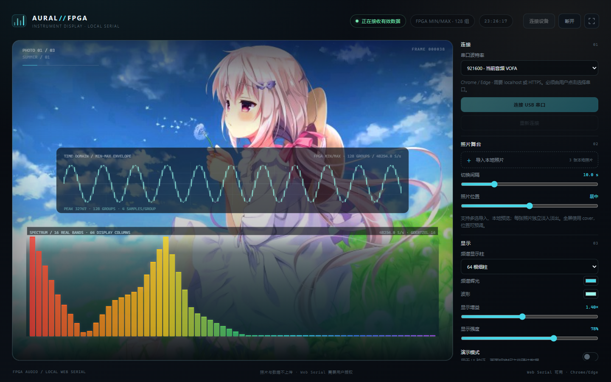
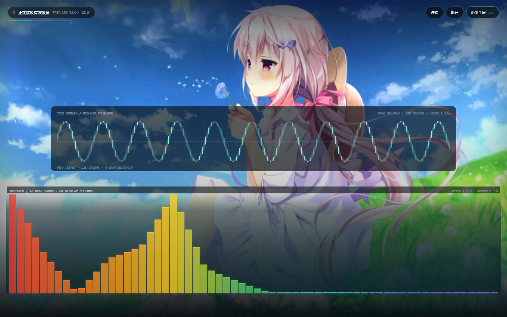
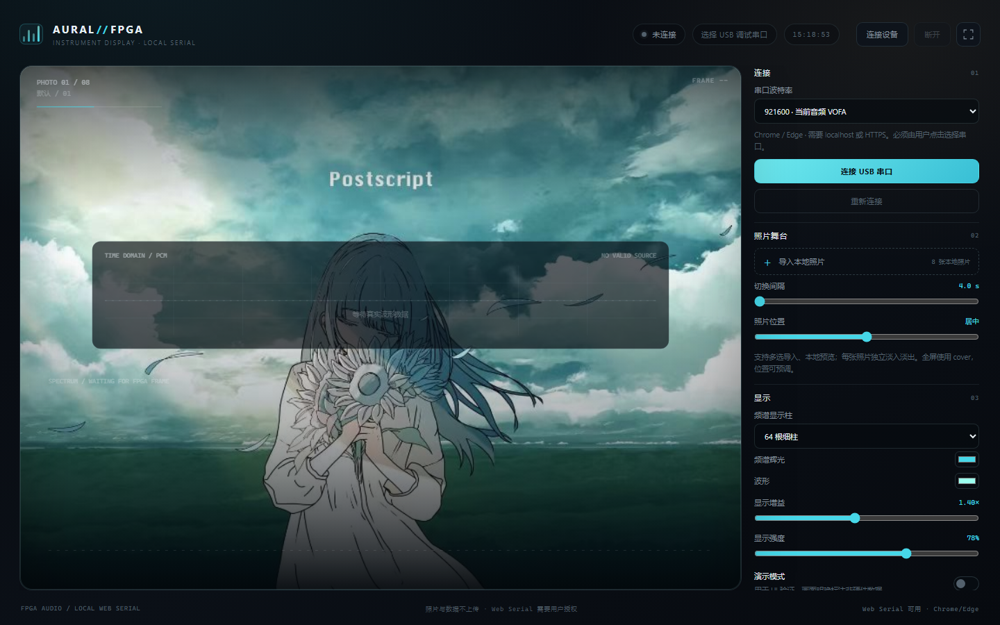
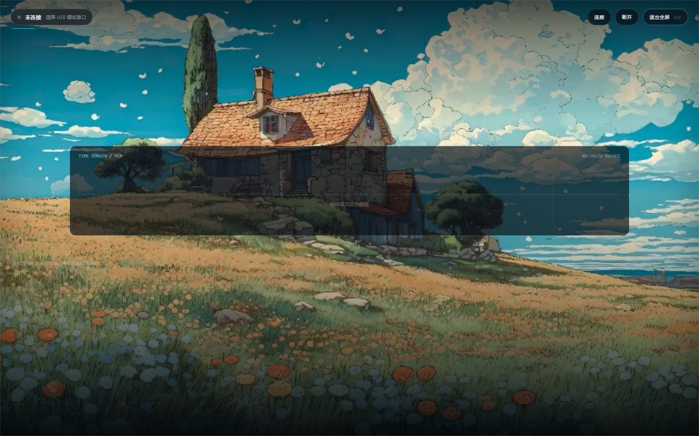

# AURAL / FPGA Instrument Display

Windows 笔记本使用的本地 FPGA 音频可视化网页。独立于 iPad App、ESP32 固件和音源默认位流；本次没有修改 FPGA、没有重新 PnR。

## 快速开始

依赖：Windows + Node.js 20.19+（Vite 7 构建）；Chrome 或 Edge。已构建的 `dist` 可直接由 Node 启动。

```powershell
cd .\DisplayWeb
npm install
npm run build
```

双击 `start.bat`（或运行 `start.ps1`）会启动本地静态服务器并打开：

```text
http://127.0.0.1:5173/
```

Web Serial 只在安全上下文可用；`localhost`/`127.0.0.1` 满足要求。首次连接必须点击页面中的“连接设备/选择串口”，浏览器会弹出串口授权窗口。

## 当前真实硬件来源

链路：

```text
FPGA U15 -> 板载 FTDI USB JTAG/UART -> USB 调试口 -> COM
```

- 921600 8N1（实际 UART 为 52.5 MHz / 57 = 921052.6 baud）。
- 当前 **USB Visualizer 候选**：`type=2`，`wave_count=256` = 128 组 `{min,max}`，16 个 Goertzel bands，`sample_rate=48254`，550 字节/帧，20 帧/s。
- 网页按 **严格 CRC16-CCITT** 校验；CRC 不匹配整帧丢弃。Fixture `tests/fixtures/usb_frame.bin`（SHA256 `285B...C78C`）已核对。
- 当前候选的频段/波形来自同一快照；页面如实显示 min/max envelope。候选的频谱验收仍有未通过项（band 0 泄漏），网页不把它标成“硬件已验证”。
- 旧音频位流仍兼容 VOFA JustFloat（8 字节/帧，约 6031.71 samples/s，无 FPGA FFT）；页面会明确标注 legacy PCM / NO FFT。
- 无数据时显示“数据中断”，不会继续假动。CH569 USB3 口不是普通 UART，当前不依赖它。
- ADC 测试工程是另一条 115200 文本遥测（`adc:...`，约 8 Hz）；网页只把它当 ADC 遥测，绝不画成音频波形。
- 诊断面板提供有界 RX 原始字节 hex/ASCII 预览，以及带 offset/长度/expected/actual CRC 的解析错误详情。

完整协议、帧头、min/max 语义、16 频段和带宽见 [docs/PROTOCOL.md](docs/PROTOCOL.md)。

## 页面功能

- 全幅照片舞台：照片 cover 填满显示区，可调上下构图；顶部元数据、底部暗化和频谱压暗层。
- 真实 16 个 FPGA bands 在显示层平滑插值为 32/64/96 根细柱（默认 64）；诊断明确显示“16 REAL BANDS / N DISPLAY COLUMNS”，不虚报真实频段数。
- 彩虹配色（红→橙→黄→绿→青→蓝→紫）、细柱间隙、柔和峰值帽与克制的辉光；频谱约占全屏高度 31%。
- 显示增益、噪声门、power 映射和上限软压缩；不做逐帧归一化，保留频段相对动态。
- 鼓点反馈只来自真实频段能量增量：低频/高频加权，快起 30 ms、慢落 240 ms；逐频段独立，不随机、不做全局同步弹跳；静音自然衰减。
- 时域波形位于画面中部，继续使用 128 组 min/max envelope，不把 256 个 int16 当逐点波形。
- 全屏为无边框照片铺满：控制面板隐藏，保留连接状态、HUD 连接/断开和退出全屏；全屏必须由用户点击触发。全屏连接、退出重进、窗口缩放和 DPR 变化均重新测量 Canvas。
- 默认 8 张本地照片（`public/photos/default-20261031-01..08.jpg`）按固定顺序播放；高清源副本保存在项目 `assets/photos/source/`，页面运行不依赖 `GowinProjects/text4/picture`。
- 本地照片多选导入、每张独立的柔和淡入淡出、默认 10 秒轮播。
- 默认照片集变更时执行一次性缓存迁移：清理旧照片索引、旧构图和旧轮播间隔，避免旧图/空白；手动导入功能保留。
- 真实串口连接、用户选择端口、可配置波特率、断开/重新连接、设备拔出处理。
- 状态：未连接、已连接等待数据、正在接收有效数据、数据中断、ADC 遥测、协议不匹配。
- 字节数、有效帧、错误帧、最近有效时间、接收速率；诊断详情可折叠。
- 诊断内包含原始字节 hex/ASCII 预览（有界，最近 2 KiB）和解析错误详情（code/offset/expected/actual CRC/长度/计数）。
- 半帧/粘帧通过有界接收缓冲持续解析；UI 只保留最新波形历史（8192 点）和最新频谱，不积压。
- 演示模式必须手动打开，页面顶部明确标注“不是硬件数据”；默认真实设备模式。

## 源码结构

```text
src/main.ts                 状态机、UI、串口/照片/渲染装配
src/serial/SerialManager.ts Web Serial 连接、reader lock、重连和错误映射
src/protocol/parser.ts      流式协议识别、min/max、JustFloat、ADC、二进制帧+严格 CRC
src/ui/RawPreview.ts        有界 RX hex/ASCII 原始字节预览
src/audio/WaveHistory.ts    有界波形历史
src/audio/DemoSource.ts     明确标注的本地演示源
src/render/PhotoDeck.ts     本地照片轮播和淡入淡出
src/render/SpectrumDisplay.ts 16→32/64/96 显示插值、彩虹、增益、峰值和逐频段瞬态
src/render/Visualizer.ts    Canvas 照片/频谱/波形绘制、全屏布局和 Resize/DPR 同步
docs/PROTOCOL.md            当前接口结论、新帧协议、带宽核算
docs/screenshots/           普通/全屏验收截图
public/photos/              8 张默认本地照片（新文件名带日期，避免旧缓存）
assets/photos/source/       高清源副本（不进入网页运行路径）
docs/DEFAULT_PHOTOS.md      默认图片顺序、尺寸、文件与哈希清单
```

## 启动脚本

- `start.bat`：双击启动。
- `start.ps1`：检查 `dist`，用 `server.mjs` 提供 `127.0.0.1:5173` 静态服务并打开浏览器。
- `npm run dev`：开发模式（Vite）。
- `npm run build`：TypeScript 检查 + 生产构建。
- `npm run check`：只做 TypeScript 检查。

如果没有 `dist`，先执行 `npm install && npm run build`。所有照片与串口数据都在本机处理，不登录、不上传云端。

## 验证状态

- TypeScript 类型检查通过；`npm test` 9 项解析测试通过。
- 默认照片检查：8 张新图全部从 `dist/photos/` 加载，旧 `photo-01/02/03` 已移除并返回 404；普通与全屏轮播均变化、刷新后仍为 8 张。
- 迁移检查：旧构图 80% 与旧轮播 25 秒被一次性清除，默认恢复为居中、10 秒；非照片设置保留。
- 重启/独立性检查：隐藏源 `picture` 目录并重启 `server.mjs` 后，8 张图片仍全部 200，页面正常。
- 浏览器页面已实际打开检查（界面、照片、Canvas、控制台）；Web Serial 硬件读取需要用户在本机点击授权。
- `npm test`：9 项解析测试通过，包括当前 USB 550 字节 fixture 的 128 组 min/max、16 bands、严格 CRC、半帧/粘帧、CRC 破坏和 min/max 顺序错误。
- 当前 fixture：`tests/fixtures/usb_frame.bin`，SHA256 `285B3781CF4876B4AEB0E37A3759F0E116194441DE2CDCE952493D09FA94C78C`。
- 浏览器实际检查：`tests/browser-check.mjs`（需要本地服务运行）验证页面、照片导入、Demo 和 Canvas；无控制台错误。
- 默认照片专项检查：`tests/browser-photo-check.mjs` 验证 8 张资源、旧素材 404、普通/全屏轮播、刷新、迁移和源目录独立性。
- 浏览器模拟串口检查：`tests/browser-serial-check.mjs` 验证连接、JustFloat、数据中断、重连、当前 min/max 帧、原始字节预览、频谱和 CRC 错误详情，不依赖真实硬件。
- 全屏/缩放检查：`tests/browser-fullscreen-check.mjs` 以当前 550 字节 fixture 以 20 Hz 持续注入，验证 64/96/32 显示柱诊断、先连接后全屏、先全屏后连接、全屏 1440×900→1920×1080 缩放、退出重进、普通窗口缩放；全屏时 Canvas CSS 尺寸与绘制缓冲一致，控制面板隐藏，HUD 状态/连接/断开/退出可用。
- DPR=2 检查：普通和全屏 Canvas 绘制缓冲分别为 CSS 尺寸的 2 倍（1596×1308 / 2400×1600），未出现二次放大。
- 普通和全屏截图：`docs/screenshots/normal.png`、`docs/screenshots/fullscreen.png`、`docs/screenshots/fullscreen-1920.png`；截图为当前 fixture 经 Web Serial 模拟端口注入，不是 U15 实机采集。
- 全屏/画面增强改动未触碰解析器、串口接收和 CRC 路径；`browser-serial-check` 的 CRC 破坏详情仍与改动前一致。
- 真实 FPGA U15/FTDI 连续数据仍需现场确认；当前候选频谱仍有 band 0 泄漏未通过验收，网页只如实显示收到的数据，不宣称硬件频谱已通过。
- 当前构建：`dist/assets/index-CoPCuTsD.js` SHA256 `AE4A52D1989BE4C56CC0CA1EBE7E962A2CD94143760D7B62F7D2ECAE99C5CC53`；`dist/assets/index-C25oNH1s.css` SHA256 `43D8400E03F206BA7A296EE2E0B1379799B1C2202F0DFB1EE406015D411EF0E9`。
- 改动前成功网页快照：`backups/InstrumentDisplayWeb_success_20261030/`。
- 本次默认照片变更前快照：`backups/InstrumentDisplayWeb_pre_photo_refresh_20261031/`。
- 默认照片完整清单：`docs/DEFAULT_PHOTOS.md`。

## 验收截图





截图环境：Edge headless、Web Serial 模拟端口注入当前 `usb_frame.bin`，持续 20 Hz；状态栏“正在接收有效数据”来自该 fixture，不代表 U15 实机频谱验收通过。

默认照片轮播验收截图（新 8 张默认图）：





## 回退/边界

- 不改 `text4` 音频默认位流；音频 Flash 不需要重刷。
- 不改 iPad App、ESP 固件、CH569 出厂固件。
- 不把 ADC 滑杆电压、音符事件或本地动画当成音频波形/硬件频谱。
- 当前 USB 候选已有 16 bands，但频谱验收未通过；网页只显示实际接收到的 bands，不修复或掩盖 FPGA 侧算法问题。
- 本轮只改网页；没有修改 ESP、iPad App、CH569 固件或 FPGA 位流。
